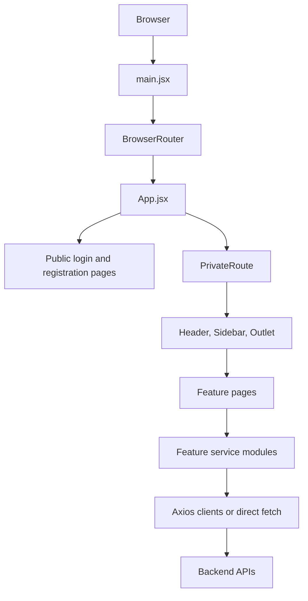

# Wayabroad Admin Panel — Project Documentation

> **Repository snapshot:** 18 November 2026. **Scope:** Current frontend source, routes, configuration, integrations, and verification state. This document replaces older planning notes and archived implementation discussions. It describes what is present in this repository; it does not certify backend behavior or production deployment.

## Contents

1. [Overview](#1-overview)
2. [Technology and scripts](#2-technology-and-scripts)
3. [Repository layout](#3-repository-layout)
4. [Application architecture](#4-application-architecture)
5. [Routes and access model](#5-routes-and-access-model)
6. [Feature areas](#6-feature-areas)
7. [API integration and configuration](#7-api-integration-and-configuration)
8. [Local development and verification](#8-local-development-and-verification)
9. [Known caveats](#9-known-caveats)
10. [Maintenance guidance](#10-maintenance-guidance)
11. [Recent change history](#11-recent-change-history)

---

## 1. Overview

Wayabroad Admin Panel is a React single-page application for internal administration of overseas education and related business workflows. It includes public login/registration pages and protected admin areas for dashboards, inquiries, applications, registrations, partner and branch management, courses, jobs, scholarships, marketing, blogs, and settings.

The frontend owns page rendering, client-side navigation, form state and validation, and calls to backend APIs. The backend remains authoritative for persistence, business rules, authentication, authorization, data scoping, and validation.

**Evidence convention**

- **In source** means the behavior or configuration is present in this repository.
- **Backend-dependent** means the UI calls an API, but the backend contract or production behavior is not established by this frontend repository.
- **Needs follow-up** identifies an observed inconsistency or verification gap, not necessarily a production incident.

## 2. Technology and scripts

### Runtime and UI

| Technology | Declared package range | Use |
|---|---:|---|
| React / React DOM | `^18.2.0` | UI and component state |
| React Router DOM | `^6.22.3` | Browser routing and nested routes |
| Vite / React plugin | `^6.2.0` / `^4.3.4` | Dev server and production build |
| Material UI / Emotion | `^5.15.13` / `^11.11.x` | Components, layout, and styling |
| Ant Design | `^5.24.7` | Tables, forms, notifications, and confirmation dialogs |
| Axios | `^1.8.4` | HTTP integrations |
| Framer Motion | `^12.7.3` | Layout and navigation animations |
| Nivo / D3 | `^0.99.0` / `^7.9.0` | Dashboard visualizations |
| TinyMCE React / TinyMCE | `^6.2.1` / `^8.3.2` | Rich text editing |
| Formik / Yup | `^2.4.6` / `^1.6.1` | Form-related dependencies; usage varies by page |
| Other declared libraries | See `package.json` | Icons, QR codes, dates, alerts, loaders, and utilities |

`package-lock.json` is committed. At the snapshot date, `npm ls --depth=0` reports installed React 18.3.1, Vite 6.4.5, React Router 6.30.6, MUI 5.18.0, and Ant Design 5.26.5. The lockfile, rather than the declared ranges above, is authoritative for a reproducible install.

### Available npm scripts

| Command | Purpose |
|---|---|
| `npm run dev` | Start the Vite development server |
| `npm run build` | Create the production bundle in `dist/` |
| `npm run preview` | Serve the built bundle locally |
| `npm run lint` | Run ESLint across the repository |

There is no test script or test-runner configuration in `package.json`.

## 3. Repository layout

```text
project-root/
├── .env.development              # Local API configuration; values are not documented here
├── .env.production               # Production API configuration; values are not documented here
├── .gitignore
├── index.html
├── package.json
├── package-lock.json
├── PROJECT_DOCUMENTATION.md
├── vite.config.js
└── src/
    ├── App.jsx                   # Route tree and application composition
    ├── main.jsx                  # React root and BrowserRouter
    ├── App.css
    ├── index.css
    ├── Admin/api/                # Course API module
    ├── assets/                   # Shared images and static assets
    └── Components/
        ├── AllLogin/             # Login screens and login services
        ├── Application/          # Application dashboard, create, list, details
        ├── Blog/                 # Blog management and service
        ├── Branch/               # Branch and staff management
        ├── Common/               # Auth guard, HTTP client, validation, shared UI
        ├── ContactUs/            # Contact Us list, form, and navigation
        ├── Courses/Continent/    # Continent-to-course hierarchy and services
        ├── FindeCouese/          # Course Finder page (source spelling retained)
        ├── IncomeExpense/        # Income/expense screen
        ├── InquiryManagement/    # Inquiry pages, filters, and services
        ├── Jobs/                 # Jobs dashboard, forms, lists, and settings
        ├── Layouts/              # Header, sidebar, layout, theme, navigation
        ├── MainDash/             # Main dashboard and service
        ├── Marketing/            # Exam preparation and web inquiry pages
        ├── OtherPages/           # Miscellaneous pages
        ├── Partner/              # Partner forms, lists, details, and service
        ├── Register/             # Registration, QR, and service
        ├── ScholarShip/          # Scholarship pages, settings, and services
        ├── Settings/             # Course/stream/blog category/conduct-by pages
        └── Utils/                # Secondary Axios client
```

The repository is JavaScript/JSX; there are no TypeScript source files. Some filenames retain historical misspellings (for example `FindeCouese`, `AppicationCreate`, `ReistrationServices`, and `ScolarshipSidebar`); import paths are case-sensitive on many deployment hosts.

## 4. Application architecture



1. `src/main.jsx` mounts the app under `BrowserRouter` and React `StrictMode`.
2. `src/App.jsx` declares public routes, a protected admin route tree, and a catch-all redirect.
3. The protected tree renders `PrivateRoute` and the shared `Layout`.
4. The layout renders a header, role-filtered sidebar, nested route content, and footer.
5. Feature pages call service modules or, in some older areas, use a client directly.

The shared interface uses Material UI and Ant Design together. Components should follow conventions in the feature folder they modify rather than assuming a single UI library.

## 5. Routes and access model

### Public and protected routes

| Route | Page / behavior |
|---|---|
| `/` | Redirect to `/wayabroadadmin` |
| `/wayabroadadmin` | Login container |
| `/wayabroadadmin/register` | Public registration |
| `/wayabroadadmin/public-inquiry` | Public inquiry registration |
| `/wayabroadadmin/admin/*` | Protected admin area |
| `*` | Redirect to `/wayabroadadmin` |

### Admin route families

All paths below are relative to `/wayabroadadmin/admin`.

| Path | Page / behavior |
|---|---|
| `dashboard` | Main dashboard |
| `Admin-Profile` | Inline “Settings Page Under Construction” placeholder |
| `CreateBranch` | Branch creation/management page |
| `incomeexpense` | Income and expense |
| `CourceFinder` | Course Finder |
| `partner` | Partner sidebar; index renders Add Partner |
| `partner/list`, `partner/web` | Partner list and web partner list |
| `application/dashboard`, `application/create`, `application/list` | Application dashboard, create, list |
| `registration`, `registration/create`, `registration/edit/:id`, `registration/list`, `registration/qr` | Registration form, edit, list, QR |
| `ContactUs`, `ContactUs/create`, `ContactUs/edit/:id` | Contact Us list and form |
| `abroadinquiry` and nested inquiry pages | Dashboard, form, list, todo, feedback, and QR |
| `Marketing/exampreparationlist`, `Marketing/webinquirylist`, `Marketing/registrationweblist` | Marketing pages under Marketing sidebar |
| `courses/continent` through `courses/course` | Education hierarchy management |
| `courses/stream` | Legacy redirect to the canonical Stream route |
| `jobs/dashboard`, `jobs/create`, `jobs/list`, `jobs/applications`, `jobs/applications/add`, `jobs/settings` | Jobs dashboard, job CRUD, applications, manual application, settings |
| `settings/stream`, `settings/course`, `settings/blogCourses`, `settings/conduct-by` | System settings; settings index redirects to Stream |
| `scholarship`, `scholarship/list`, `scholarship/lead-list`, `scholarship/settings` | Scholarship form, list, lead list, settings |
| `blog` | Blog management |

Nested route details are defined in [App.jsx](./src/App.jsx).

### Authentication and role visibility

- `PrivateRoute` checks whether `sessionStorage.authToken` exists; without it, the user is redirected to the login route.
- Login pages store token and role/session fields in `sessionStorage`. Sidebar entries use role lists to control visibility.
- The Jobs sidebar exposes dashboard/list/applications to `superAdmin` and `branch`; Create Job and Job Settings are limited to `superAdmin`. `JobsSidebar` also redirects branch users away from the create and settings paths.
- This is frontend navigation behavior, not a security boundary. The backend must validate tokens, roles, and record scope on every protected API request.

## 6. Feature areas

This inventory summarizes the current route components and service structure; it does not imply that every backend endpoint is available in every environment.

| Area | Current implementation in source |
|---|---|
| Login and public access | Super Admin, Branch, and Staff login screens; login, OTP/password reset and branch mapping service calls; public registration and public inquiry routes. |
| Main dashboard | Main admin dashboard with a separate dashboard service. |
| Branch | Branch creation and staff management components/services. |
| Inquiry Management | Dashboard, inquiry form/list, todo, feedback, QR, detail/edit/filter components, and dedicated service modules. |
| Application Management | Application dashboard, create, list, detail modal, edit dialog, filters, document UI, and application services. |
| Registration | Registration form/list/edit dialog, filters, QR generation, and registration services. |
| Partner | Add/edit partner, partner list/web list, detail modal, filters, document upload, and partner service. |
| Contact Us | Contact Us list/form and separate sidebar components. |
| Marketing | Exam Preparation, Web Inquiry, and Registration Web list route components. The Registration Web list is present in the route tree; verify its current completeness before treating it as a finished workflow. |
| Courses | Continent → Country → State → City → University → College → Stream → Course screens and entity services. `CourseEntityRoute` handles parent selection and route context. |
| Course Finder | Separate discovery page at the legacy `CourceFinder` route. |
| Jobs Management | Dashboard, job list, create/edit form, row-detail/edit dialog, application list and status workflow, manual application, settings, country setting dialog, and a shared `JobService`. |
| Scholarship | Scholarship form/list, lead form/list, settings, category/type/study-location services, filters, rich-text descriptions, and file handling. The list UI treats the existing `testDate` field as a month, supports a Scholarship Link column, and validates Amount as a non-negative number. |
| Blog | Blog management and service. |
| Settings | Stream, course, blog category, and conduct-by management. |
| Income & Expense | Financial management page. |

### Education course hierarchy

The frontend navigation model is:

```text
Continent → Country → State → City → University → College → Stream → Course
```

Parent IDs are passed as route context/query parameters by `CourseEntityRoute`. Preserve the correct parent ID when moving between entity levels; confirm any foreign-key or payload changes with the backend. The actual database relationships are not part of this repository.

### Jobs Management details

- Job List includes overview cards, filters for keyword, education, sector/role, country, job type, work type, experience, salary and active status, plus pagination and delete confirmation.
- Filter changes are debounced and reload the results automatically. Experience-range filtering is applied to all server-filtered pages fetched by the client; other filters use the search endpoint and its paginated response.
- Clicking a row opens `JobDetailDialog`. The dialog initially shows details and loads the full job record. An authorized user can choose **Edit** to enter an in-dialog edit form; the explicit `type="button"` and `preventDefault()` guard prevents that action from acting as a submit. **Update** is the form's explicit submit button.
- Job Applications provides overview/status summaries, search/filter controls, detail view, status update, deactivation, and manual application navigation.
- Job settings cover education, sector, role, currency, job type, location, country, and work type.
- The frontend status labels currently include `PENDING`, `SHORTLISTED`, `INTERESTED`, `PROCESS_1`, `PROCESS_2`, `APPLY_LATER`, and `SELECTED`. Treat the server enum as authoritative.

## 7. API integration and configuration

### HTTP clients

The current source has more than one HTTP integration pattern:

- `Components/Common/axiosConfig.js` uses `VITE_API_BASE_URL` (fallback `http://localhost:8080`), attaches the current bearer token unless a request sets `skipAuth`, and shows a session-expired alert/redirect for authenticated 401 responses.
- `Components/Utils/axiosConfig.js` uses `VITE_ADMIN_API_BASE_URL` (same localhost fallback) and attaches the current token.
- `AllLogin/LoginService.js` creates a separate Axios client using `VITE_ADMIN_API_BASE_URL`. Some pages and services also use direct `fetch` or direct Axios calls.
- Course image/asset URLs in some components use `VITE_API_URL`.

The environment files contain local values and are intentionally not reproduced in this document. The variable names found in source are `VITE_API_BASE_URL`, `VITE_ADMIN_API_BASE_URL`, `VITE_API_URL`, and Vite's `BASE_URL`. Do not place credentials or private secrets in client-exposed Vite variables.

### Service boundaries and verified Jobs API paths

Most feature areas have service modules that encapsulate API requests, though this pattern is not universal. The Jobs service (`Components/Jobs/JobService.js`) currently references:

| Purpose | Endpoint |
|---|---|
| Search jobs | `GET /admin/jobs/search` |
| Read job | `GET /admin/jobs/{id}` |
| Create/update/delete job | `POST /admin/jobs`, `PUT /admin/jobs/{id}`, `DELETE /admin/jobs/{id}` |
| Job settings | `/admin/job-settings/{education,sector,role,currency,job-type,location,country,work-type}` |
| Search applications | `GET /job-applications/admin/search` |
| Read application | `GET /job-applications/admin/{id}` |
| Update application status | `PUT /job-applications/admin/{id}/status` |
| Deactivate application | `DELETE /job-applications/admin/{id}` |
| Submit application | `POST /job-applications/apply` (multipart form data) |

The service attaches session `role` and `email` parameters to relevant requests. These values are caller context, not proof of authorization. Other module endpoint contracts are maintained in their respective service files and are not exhaustively catalogued here; consult those files and the backend API specification before changing request/response shapes.

### Deployment base

`vite.config.js` sets `base: "/wayabroadadmin/"`, and `package.json` declares the matching homepage. The deployment host must serve built assets at this prefix and return the SPA entry point for supported nested routes. Production routing, CORS, TLS, and API availability are outside this repository.

## 8. Local development and verification

### Setup

Use the Node.js/npm version approved for the project. From the repository root:

```bash
npm ci
npm run dev
```

Use `npm install` only when intentionally changing dependencies. Configure the required `VITE_*` API values in the appropriate local environment file; do not commit secrets.

### Build, lint, and preview

```bash
npm run lint
npm run build
npm run preview
```

### Verification snapshot on 18 November 2026

- `npm run build` completed successfully. Vite reported existing duplicate object-key warnings in `AbroadInquiryForm.jsx`, `CourseFinder.jsx`, and `Sidebar.jsx`, plus a mixed static/dynamic import warning for `StaffService.js` and a large bundle warning.
- `npx eslint src/Components/Jobs/JobDetailDialog.jsx` passed after the latest Job List Edit-action safeguard.
- `npm run lint` did **not** pass: ESLint reported 150 errors and 35 warnings across the repository. Findings include unused variables, undefined names, duplicate object keys, and hook-dependency warnings. The full lint report should be reviewed and cleaned up separately; this documentation update does not fix those unrelated issues.
- There is no configured automated unit/integration test command. Validate critical flows manually against an authorized test backend, including direct route refresh and role-restricted actions.

### High-value smoke tests

- Login, session expiry, logout/redirect, and role-specific sidebar visibility.
- Direct access and refresh for nested routes.
- Course hierarchy parent selection and forward/back navigation.
- Job List row click opens detail only; Edit opens the edit form without submitting; Update submits once; Cancel/Close do not submit.
- Job filters work together, clear/reset correctly, and retain correct pagination.
- Job application status update and deactivation against the backend-supported status set.
- Scholarship create/edit prefill, month conversion, file handling, link rendering, and Amount validation.
- Loading, empty, API error, validation, and success states for changed module workflows.

## 9. Known caveats

1. **Duplicate Marketing route:** `App.jsx` declares two sibling routes with `path="Marketing"`—one renders `BlogManagement`, another renders `MarketingSideBar` and nested Marketing pages. Consolidate only after confirming intended behavior and preserving existing links.
2. **Course Finder path mismatch:** the route is `CourceFinder`, while the navigation segment is `/CourceFinder ` with a trailing space. This can prevent navigation from matching the route.
3. **Mixed API configuration:** multiple Axios clients and direct requests use different environment variable names and fallback patterns. Review carefully before centralizing them; a shared change can affect several modules.
4. **Frontend access controls are not authorization:** `PrivateRoute` checks for token presence and navigation entries filter by role, but only the backend can enforce permissions and record scope.
5. **Application statuses:** the frontend declares seven status values. Confirm the current backend enum and allowed transitions before modifying labels or actions.
6. **Legacy field names:** several pages/services use historic spellings and backend-specific field names. Do not normalize these without coordinated API changes.
7. **Production behavior is unverified:** this repository does not include backend source, API specification, database schema, deployment-server config, or a production browser test.

## 10. Maintenance guidance

- Keep route definitions in `src/App.jsx` and sidebar navigation entries synchronized. Check casing, trailing whitespace, nested paths, and role visibility together.
- Keep API request logic in the established feature service where feasible. Preserve request parameters, payloads, response normalization, authentication behavior, and error visibility.
- Before adding filters, establish whether data is paginated by the server or fully loaded in the browser. Do not paginate an already paginated response a second time.
- For async React effects, handle unmount/stale responses and clear loading state on both success and failure.
- Make non-submit buttons inside forms explicitly `type="button"`; reserve `type="submit"` for the intended form action.
- Preserve parent/child IDs in the course hierarchy and reset descendant selections when the parent changes.
- Keep production secrets out of source, docs, and client-side variables.
- Before a code change is committed, review `git diff`, run targeted lint/tests, and run a production build when appropriate. Keep generated `dist/`, `node_modules/`, archives, and local configuration out of commits unless explicitly required.

## 11. Recent change history

| Date | Change |
|---|---|
| 4–5 November 2026 | Job creation and Job List changes. |
| 17 November 2026 | Expanded Job Management implementation, including dashboard, detail/edit dialog, application workflows, and job settings. |
| 18 November 2026 | Fixed the Job List detail dialog's Edit action so it is explicitly a non-submit button and prevents a browser-default form submission; the explicit Update control remains the form submitter. |
| 18 November 2026 | Updated this documentation to reflect the current repository routes, modules, integrations, verification state, and known caveats. |
