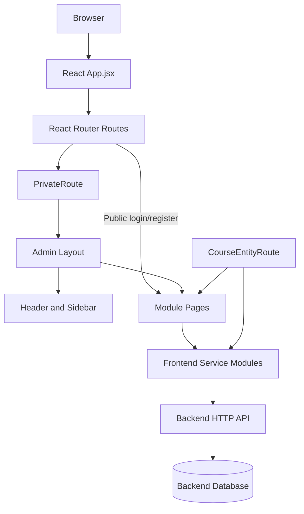
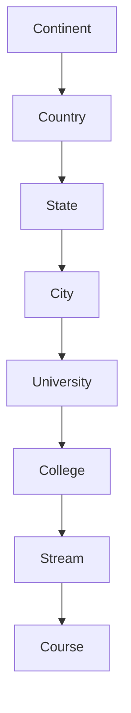

# Wayabroad Admin Panel — Project Documentation

> **Document purpose:** Technical reference for onboarding, maintenance, debugging, and future frontend development.
>
> **Documentation status:** Initially prepared from frontend source excerpts available on 12 October 2026, then updated on 19 October 2026 with the documented Day 3 Jobs Management and Day 4 Inquiry List UI changes. This remains a source-grounded working reference, not a claim that every module or backend contract has been exhaustively audited. Day 5 Job form-field changes are intentionally excluded from this update. Verify the items listed in [Missing Information and Verification Checklist](#missing-information-and-verification-checklist) against the current repository before treating this document as a release specification.

## Table of Contents

1. [Project Overview](#1-project-overview)
2. [Technology Stack](#2-technology-stack)
3. [Project Directory Structure](#3-project-directory-structure)
4. [Architecture Diagram](#4-architecture-diagram)
5. [Module-wise Documentation](#5-module-wise-documentation)
6. [Routing and Navigation](#6-routing-and-navigation)
7. [Hierarchical Data Flow](#7-hierarchical-data-flow)
8. [API and Backend Dependencies](#8-api-and-backend-dependencies)
9. [Shared Components and UI Design](#9-shared-components-and-ui-design)
10. [Development Environment Setup](#10-development-environment-setup)
11. [Running and Testing the Application](#11-running-and-testing-the-application)
12. [Known Issues and Limitations](#12-known-issues-and-limitations)
13. [Future Development Guidelines](#13-future-development-guidelines)
14. [Glossary of Important Technical Terms](#14-glossary-of-important-technical-terms)
15. [Missing Information and Verification Checklist](#missing-information-and-verification-checklist)

---

## 1. Project Overview

### 1.1 Purpose

Wayabroad Admin Panel is a React single-page application (SPA) used to operate administrative workflows related to overseas education and business operations. The available route configuration includes dashboard, inquiry, application, registration, branch, partner, income/expense, course discovery, education-course data management, marketing, scholarship, blog, and settings areas.

The frontend provides screens, navigation, forms, tables, local filtering/pagination, and API calls through service modules. Persistent business data and server-side rules are outside the frontend's authority and depend on backend APIs.

### 1.2 Frontend/backend ownership

| Area | Frontend responsibility | Backend dependency |
|---|---|---|
| Pages and layout | React components, visual states, responsive layout | None for static rendering |
| Navigation | React Router routes, sidebar, query-string context | Server hosting must support SPA fallback for direct URL refresh |
| Forms | Inputs, local state, client-side validation where implemented | Validation, persistence, authorization and business rules must be enforced server-side |
| Tables | Rendering, local search and page slicing where implemented | API must supply records; server pagination is not assumed |
| Education hierarchy | Select parent entity, pass IDs, navigate between entity pages | APIs must return correct entities and preserve relationships |
| Authentication | `PrivateRoute` is used around admin layout; session values are read by components | Actual login verification, token/session validity and permission enforcement need backend confirmation |
| CRUD | UI invokes service functions for create/read/update/delete | Endpoints, database writes, uploads and data integrity are backend responsibilities |
| Configuration | Vite base path and frontend build scripts | Production server, API origin, CORS, routing rewrites and TLS are deployment/backend concerns |

### 1.3 Evidence labels used in this document

- **Confirmed from code:** Directly visible in the source excerpts reviewed.
- **Reported working:** The project owner confirmed the education hierarchy's forward and backward navigation worked in their environment.
- **Needs verification:** The available excerpts do not prove the behavior or contract.
- **Recommendation:** A suggested engineering practice, not a claim about current implementation.

---

## 2. Technology Stack

The package manifest excerpt identifies the following declared versions/ranges. These are package ranges, not necessarily the exact installed versions in `package-lock.json`.

| Technology | Declared version/range | Purpose visible or typical in this project |
|---|---:|---|
| React / React DOM | `^18.2.0` | Component-based frontend |
| Vite | `^6.2.0` | Development server and production bundler |
| `@vitejs/plugin-react` | `^4.3.4` | React support in Vite |
| React Router DOM | `^6.22.3` | Client-side route configuration and navigation |
| Material UI | `^5.15.13` | Layout, forms, dialogs, controls and theme |
| MUI icons | `^5.15.13` | Interface icons |
| Emotion | `^11.11.1` / `^11.11.0` | Styling engine used by MUI |
| Ant Design (`antd`) | `^5.24.7` | Tables, search inputs, confirmation dialogs and messages in reviewed course components |
| Axios | `^1.8.4` | HTTP client dependency; service usage should be verified in each service |
| Framer Motion | `^12.7.3` | Sidebar/content animation |
| Formik | `^2.4.6` | Form helper dependency; usage varies by module and requires inspection |
| Yup | `^1.6.1` | Schema validation dependency; usage varies by module and requires inspection |
| `jwt-decode` | `^4.0.0` | JWT decoding dependency; does not itself validate a token |
| Nivo bar/pie/core | `^0.99.0` | Charting dependencies |
| D3 | `^7.9.0` | Data visualization utilities |
| TinyMCE React / TinyMCE | `^6.2.1` / `^8.3.2` | Rich-text editing dependencies |
| `react-datepicker` | `^8.4.0` | Date-picker dependency |
| `lucide-react` | `^0.506.0` | Icon dependency |
| `qrcode` | `^1.5.4` | QR-code generation dependency |
| `sweetalert2` | `^11.19.1` | Alert/dialog dependency |
| `uuid` | `^11.1.0` | UUID utility |
| `@fontsource/poppins` | `^5.2.5` | Poppins font assets |
| `ldrs` | `^1.1.6` | Loader dependency |

### 2.1 Build scripts

The reviewed `package.json` defines:

```json
{
  "scripts": {
    "dev": "vite",
    "build": "vite build",
    "lint": "eslint .",
    "preview": "vite preview"
  }
}
```

### 2.2 Runtime and deployment base

The reviewed `vite.config.js` sets:

```js
base: "/wayabroadadmin/"
```

The package manifest also declares the homepage as `https://wayabroad.in/wayabroadadmin/`. This indicates a deployment intended to be served under the `/wayabroadadmin/` path. Confirm that the production server's static files and SPA fallback match this path.

---

## 3. Project Directory Structure

The complete repository tree was not available in the reviewed material. The following is a **partial, code-confirmed reference** of directories and files imported by `src/App.jsx` and the education hierarchy components. File and folder casing should be preserved exactly, especially on case-sensitive deployment systems.

```text
project-root/
├── package.json
├── package-lock.json                 # Expected for npm reproducibility; verify present
├── vite.config.js
├── index.html                        # Vite entry HTML; verify actual file
└── src/
    ├── App.jsx                       # Main route tree
    ├── Components/
    │   ├── AllLogin/
    │   │   └── SidebarLoginContainer # Lazy-loaded public/login entry
    │   ├── Common/
    │   │   ├── PrivateRoute          # Admin route wrapper
    │   │   ├── LoadingOverlay        # Loading UI
    │   │   └── ErrorBoundary         # Error boundary wrapper
    │   ├── Layouts/
    │   │   ├── Layout.jsx            # Shared admin shell and Outlet
    │   │   ├── Header                # Header component
    │   │   ├── Sidebar               # Role-filtered sidebar
    │   │   └── Theme.jsx             # MUI theme
    │   ├── MainDash/
    │   │   └── MainDashboard
    │   ├── Branch/
    │   │   └── CreateBranch.jsx
    │   ├── InquiryManagement/
    │   │   ├── InquirySidebar.jsx
    │   │   └── Pages/
    │   │       ├── AbroadInquiryForm.jsx
    │   │       ├── AbroadInquiryList.jsx
    │   │       ├── AbroadInquiryTodo.jsx
    │   │       ├── AbroadInquiryFeedback.jsx
    │   │       ├── AbroadInquiryDashboard.jsx
    │   │       └── AbroadInquiryQR.jsx
    │   ├── Jobs/
    │   │   ├── JobService.js
    │   │   ├── JobsSidebar.jsx
    │   │   ├── JobForm.jsx
    │   │   ├── JobList.jsx
    │   │   ├── JobApplications.jsx
    │   │   └── JobSettings.jsx
    │   ├── Courses/
    │   │   └── Continent/
    │   │       ├── ContinentRelation.jsx
    │   │       ├── ContinentService
    │   │       ├── CourseEntityRoute.jsx
    │   │       ├── Country.jsx / CountryService
    │   │       ├── State.jsx / StateService
    │   │       ├── City.jsx / CityService
    │   │       ├── University.jsx / UniversityService
    │   │       ├── College.jsx / CollegeService
    │   │       ├── Stream.jsx / StreamService
    │   │       └── Course.jsx / CourseService
    │   ├── Settings/
    │   ├── Partner/
    │   ├── Application/
    │   ├── Register/
    │   ├── ContactUs/
    │   ├── Marketing/
    │   ├── ScholarShip/
    │   └── Blog/
    └── assets/
        └── Images/
            └── LOGO.png
```

**Important:** This tree is not a complete inventory. Some extensions are omitted in imports in `App.jsx`; use the actual repository to confirm each filename. Do not create missing files just because they appear as inferred placeholders above.

### 3.1 Key files

| File | Responsibility |
|---|---|
| `src/App.jsx` | Declares public and protected routes; imports module pages and shared wrappers |
| `src/Components/Common/PrivateRoute` | Wraps the `/wayabroadadmin/admin` route tree; exact authorization logic needs source review |
| `src/Components/Layouts/Layout.jsx` | Header/sidebar shell, responsive sidebar state, nested route outlet and footer |
| `src/Components/Layouts/Sidebar.jsx` | Role-filtered navigation, collapsible Courses submenu and active route styling |
| `src/Components/Layouts/Theme.jsx` | MUI theme configuration |
| `src/Components/Courses/Continent/CourseEntityRoute.jsx` | Shared wrapper for Country, State, City, University, College, Stream and Course pages |
| `src/Components/Courses/Continent/ContinentRelation.jsx` | Continent CRUD screen and entry point into the education hierarchy |
| `src/Components/Courses/Continent/*Service*` | API/service integration for hierarchy entities; exact endpoint definitions require service-file inspection |

---

## 4. Architecture Diagram

### 4.1 Runtime architecture



The backend/database boxes show the expected integration pattern. The backend implementation and database schema were not supplied for this documentation pass, so their internal design is not confirmed.

### 4.2 Typical data flow

1. A user opens a route.
2. React Router selects a route element from `App.jsx`.
3. Protected admin routes are wrapped by `PrivateRoute` and render the shared `Layout`.
4. The page component reads local UI state and, where applicable, session values such as `role`, `email`, and `branchCode`.
5. The component calls a service function.
6. The service communicates with a backend endpoint.
7. The component stores the returned data in React state and renders the result.
8. Create/update/delete actions call service functions and then commonly refresh the list or show a message.

The exact HTTP request and response formats must be read from the relevant service and backend controller. Do not infer them from component names.

---

## 5. Module-wise Documentation

This section lists modules proven by `App.jsx` route imports and route definitions. The existence of a route does not prove every feature is complete or that every API succeeds.

| Module | Main route(s) | Main component(s) visible in route config | Current evidence / notes |
|---|---|---|---|
| Login | `/wayabroadadmin` | `SidebarLoginContainer` (lazy-loaded) | Public entry. Authentication implementation needs inspection. |
| Public Registration | `/wayabroadadmin/register` | `PublicRegistration` | Public registration route exists. API and validation need inspection. |
| Main Dashboard | `/wayabroadadmin/admin/dashboard` | `MainDashboard` | Dashboard route exists. Data widgets/endpoints need inspection. |
| Branch | `/wayabroadadmin/admin/CreateBranch` | `CreateBranch` | Branch page route exists. |
| Income & Expense | `/wayabroadadmin/admin/incomeexpense` | `IncomeExpense` | Route exists; financial calculations and APIs need inspection. |
| Course Finder | `/wayabroadadmin/admin/CourceFinder` | `CourseFinder` | Route config uses this spelling. Sidebar configuration contains a trailing space in the segment; see routing limitations. |
| Partner Details | `/wayabroadadmin/admin/partner` | `PartnerSidebar`, nested `AddPartner`, `PartnerList`, `PartnerWebList` | Parent and nested routes exist. |
| Inquiry Management | `/wayabroadadmin/admin/abroadinquiry` | `InquirySidebar`, dashboard/form/list/todo/feedback/QR pages | Nested routes are explicitly configured. The Day 4 update changes the Inquiry List filters, status tabs, record count and page-size control; see section 5.5. |
| Application Management | `/wayabroadadmin/admin/application` | `ApplicationSidebar`, `ApplicationDashboard`, `AppicationCreate`, `ApplicationList` | Index redirects/rendering are configured. `AppicationCreate` is the actual imported spelling. |
| Registration Management | `/wayabroadadmin/admin/registration` | `RegistrationSidebar`, `RegisterForm`, `RegisterList`, `RegistrationQRForm` | Create/list/edit/QR paths exist. |
| Contact Us | `/wayabroadadmin/admin/ContactUs` | `ContactUsSidebar`, `ContactUsList`, `ContactUsForm` | Route exists, but its sidebar navigation entry is commented out in the reviewed navigation config. |
| Marketing | `/wayabroadadmin/admin/Marketing` | Both `BlogManagement` and `MarketingSideBar` are declared for the same parent path | **Route conflict risk:** duplicate parent route declarations exist in `App.jsx`; verify intended behavior and consolidate carefully. |
| Courses | `/wayabroadadmin/admin/courses/*` | `ContinentRelation`, `CourseEntityRoute` | Entity routes exist for continent through course. Details in sections 6–8. |
| Jobs Management | `/wayabroadadmin/admin/jobs/*` | `JobsSidebar`, `JobForm`, `JobList`, `JobApplications`, `JobSettings` | Added for `superAdmin` navigation; create/list/applications/settings subroutes and API service are documented in section 5.4. |
| Settings | `/wayabroadadmin/admin/settings` | `SettingSidebar`, stream/course/blog category/conduct-by pages | Nested settings routes exist. |
| Scholarship | `/wayabroadadmin/admin/scholarship` | `ScholarshipSidebar`, form/list/lead-list/settings | Lead-form route is commented out. |
| Blog Management | `/wayabroadadmin/admin/blog` | `BlogManagement` | Parent route and index route render `BlogManagement`; outlet behavior needs inspection. |
| Admin Profile placeholder | `/wayabroadadmin/admin/Admin-Profile` | Inline “Settings Page Under Construction” | Explicit placeholder in route config. |

### 5.1 Course Finder versus Courses

These are separate route concepts:
- **Course Finder** is configured as `/wayabroadadmin/admin/CourceFinder` in `App.jsx`.
- **Courses** is configured under `/wayabroadadmin/admin/courses` and manages the education hierarchy.

The unusual `CourceFinder` spelling should not be silently corrected without checking existing links and deployment expectations.

### 5.2 Education hierarchy entity screens

The shared route wrapper configures these child screens:

| Entity page | Component | Parent selection loaded through |
|---|---|---|
| Country | `Country` | `getAllContinents(role, email)` |
| State | `State` | `getAllCountries({ role, email })` |
| City | `City` | `StateService.getAllStates(role, email)` |
| University | `University` | `CityService.getAllCities(role, email)` |
| College | `College` | `getAllUniversity({ role, email, branchCode })` |
| Stream | `Stream` | `getAllColleges({ role, email, branchCode })` |
| Course | `Course` | `getAllStreams({ role, email, branchCode })`, plus colleges for the create context |

The route wrapper renders a parent selector before rendering the corresponding entity component. The Course page also requires a College selection for the create context in the reviewed implementation.

### 5.3 Common page-level behaviors seen in reviewed hierarchy components

`ContinentRelation.jsx`, `City.jsx`, and `Course.jsx` excerpts show patterns including:
- React local state for fetched records, dialogs, editing state, search, loading and pagination.
- Service calls inside async functions, commonly triggered by `useEffect`.
- Error messages through Ant Design `message`.
- Material UI layout/forms/dialogs and Ant Design tables/search controls.
- Local filtering and client-side page slicing in at least some components.
- Create/update/delete actions routed through service functions.

These behaviors should not be assumed for every module without reviewing its component code.

### 5.4 Jobs Management — Day 3 implementation

The Jobs Management frontend was added as a separate admin section and uses the existing React Router/admin sidebar architecture. The Jobs navigation entry is intended for the `superAdmin` role. The addition should preserve existing Courses navigation behavior.

**Files added**
- `src/Components/Jobs/JobService.js` — centralizes job CRUD/search, job-settings and application API calls.
- `src/Components/Jobs/JobsSidebar.jsx` — nested navigation for Jobs Management subpages.
- `src/Components/Jobs/JobForm.jsx` — Create Job / Edit Job form.
- `src/Components/Jobs/JobList.jsx` — searchable/filterable job listing, pagination and supported actions.
- `src/Components/Jobs/JobApplications.jsx` — application listing, details and supported status management.
- `src/Components/Jobs/JobSettings.jsx` — master-data management for the six existing settings resources.

**Files modified**
- `src/App.jsx` — adds nested Jobs routes.
- `src/Components/Layouts/SidebarNavigation.jsx` — adds Jobs Management navigation for `superAdmin`.
- `src/Components/Layouts/Sidebar.jsx` — maintains Jobs submenu active/expanded state separately while preserving Courses submenu behavior.

**Routes**

| Route under `/wayabroadadmin` | Component / behavior |
|---|---|
| `/admin/jobs` | `JobsSidebar`; index redirects to `jobs/create` |
| `/admin/jobs/create` | `JobForm` |
| `/admin/jobs/list` | `JobList` |
| `/admin/jobs/applications` | `JobApplications` |
| `/admin/jobs/settings` | `JobSettings` |

**API integration documented for this implementation**

- Jobs: `POST /admin/jobs`, `GET /admin/jobs/{id}`, `PUT /admin/jobs/{id}`, `DELETE /admin/jobs/{id}`, and `GET /admin/jobs/search`.
- Applications: `GET /job-applications/admin/search`, `GET /job-applications/admin/{id}`, `PUT /job-applications/admin/{id}/status`, and `DELETE /job-applications/admin/{id}`. The delete operation deactivates an application according to the documented backend behavior.
- Job Settings: `/admin/job-settings/education`, `/sector`, `/role`, `/currency`, `/job-type`, and `/location`. The current documented relationships are Education → Sector → Role; Sector options are filtered by Education and Role options by Sector.
- The originally documented Job payload uses `jobTitle`, `educationId`, `sectorId`, `jobRoleId`, `skill`, `openings`, `locationId`, `salary`, `currencyId`, `jobTypeId`, `description`, and `active`. Country/free-text Location, multi-select Skills, Work Type and Experience Level changes discussed for Day 5 are not represented as implemented in this document.
- The currently documented application statuses are `PENDING`, `SHORTLISTED`, `REJECTED`, and `HIRED`. The application search parameters documented for this implementation are `jobId`, `status`, `applicantEmail`, `page`, and `size`.

**Verification status and cautions**

The original frontend source package used for the Jobs implementation did not include `package.json` or a lockfile, and no live backend was available. Implementation notes record JSX/JavaScript syntax checks and relative-import checks, but not a full Vite build or live API CRUD verification. Validate Jobs workflows against the actual repository and an authorized test account before release. The shared Axios configuration was separately noted to contain a hardcoded JWT fallback and token logging; this was not modified as part of the Jobs work and should be addressed before production deployment.

### 5.5 Inquiry List UI — Day 4 implementation

The Day 4 update is limited to the Inquiry List UI; no backend/API contract changes were made.

**Files modified**
- `src/Components/InquiryManagement/Pages/AbroadInquiryList.jsx`
- `src/Components/InquiryManagement/Pages/InquiryFilter.jsx`

**Changes**
- Removed the Continent, State and Status dropdown filters from the filter area.
- Added a Passport Yes/No dropdown using the existing `hasPassport` field.
- Removed the Total count card and reworked the nine existing status counters as selectable tabs. Selecting a tab applies the existing status filter; clicking the selected tab again clears it.
- Made status tabs fit across desktop width and scroll horizontally on smaller screens.
- Added a page-size selector next to the record-count label while retaining the existing page-size options.
- Corrected the zero-results range so the UI does not display a misleading `1-0` count.

**API and test notes**

The Passport filter is applied client-side to records returned by the existing inquiry filtering API. If the API returns only a server-paginated subset, Passport results and counts are limited to that subset; complete-dataset filtering would require backend support. The Day 4 implementation notes report JSX syntax checks passing for both modified files, but a full Vite build, browser interaction tests and live API tests were not run.

---

## 6. Routing and Navigation

### 6.1 Base paths

- Root `/` redirects to `/wayabroadadmin`.
- Public login route: `/wayabroadadmin`.
- Public registration route: `/wayabroadadmin/register`.
- Protected admin route parent: `/wayabroadadmin/admin`.
- Vite deployment base: `/wayabroadadmin/`.

### 6.2 Main routes

| Route | Rendered component / behavior |
|---|---|
| `/` | Redirects to `/wayabroadadmin` |
| `/wayabroadadmin` | `SidebarLoginContainer` |
| `/wayabroadadmin/register` | `PublicRegistration` |
| `/wayabroadadmin/admin` | `PrivateRoute` → `Layout` |
| `/wayabroadadmin/admin/dashboard` | `MainDashboard` |
| `/wayabroadadmin/admin/CreateBranch` | `CreateBranch` |
| `/wayabroadadmin/admin/incomeexpense` | `IncomeExpense` |
| `/wayabroadadmin/admin/CourceFinder` | `CourseFinder` |
| `/wayabroadadmin/admin/partner` | `PartnerSidebar` index → `AddPartner` |
| `/wayabroadadmin/admin/partner/list` | `PartnerList` |
| `/wayabroadadmin/admin/partner/web` | `PartnerWebList` |
| `/wayabroadadmin/admin/abroadinquiry` | `InquirySidebar` index → `AbroadInquiryDashboard` |
| `/wayabroadadmin/admin/application` | `ApplicationSidebar` index → `ApplicationDashboard` |
| `/wayabroadadmin/admin/registration` | `RegistrationSidebar` index → `RegisterForm` |
| `/wayabroadadmin/admin/ContactUs` | `ContactUsSidebar` index → `ContactUsList` |
| `/wayabroadadmin/admin/Marketing` | Duplicate route definitions; see limitations |
| `/wayabroadadmin/admin/jobs` | `JobsSidebar` parent; redirects to `jobs/create` |
| `/wayabroadadmin/admin/jobs/create` | `JobForm` (create/edit; edit ID is passed through `?editId=<id>`) |
| `/wayabroadadmin/admin/jobs/list` | `JobList` |
| `/wayabroadadmin/admin/jobs/applications` | `JobApplications` |
| `/wayabroadadmin/admin/jobs/settings` | `JobSettings` |
| `/wayabroadadmin/admin/courses` | Redirects to `courses/continent` |
| `/wayabroadadmin/admin/courses/continent` | `ContinentRelation` |
| `/wayabroadadmin/admin/courses/country` | `CourseEntityRoute entity="country"` |
| `/wayabroadadmin/admin/courses/state` | `CourseEntityRoute entity="state"` |
| `/wayabroadadmin/admin/courses/city` | `CourseEntityRoute entity="city"` |
| `/wayabroadadmin/admin/courses/university` | `CourseEntityRoute entity="university"` |
| `/wayabroadadmin/admin/courses/college` | `CourseEntityRoute entity="college"` |
| `/wayabroadadmin/admin/courses/stream` | `CourseEntityRoute entity="stream"` |
| `/wayabroadadmin/admin/courses/course` | `CourseEntityRoute entity="course"` |
| `/wayabroadadmin/admin/settings` | `SettingSidebar` index redirects to `settings/stream` |
| `/wayabroadadmin/admin/scholarship` | `ScholarshipSidebar` index → `ScholarShipForm` |
| `/wayabroadadmin/admin/blog` | `BlogManagement` parent and index |
| `*` | Redirects to `/wayabroadadmin` |

Nested route details for every child page are in `src/App.jsx`; this table intentionally focuses on the main route families.

### 6.3 Shared layout and outlet

The admin parent route renders `Layout`, which contains:
- `Header`
- `Sidebar`
- `Outlet` for the selected child route
- A footer with a Wayabroad/PJSoftTech link and copyright text

The layout uses MUI breakpoints to set the sidebar closed on small screens and uses Framer Motion to animate the content region.

### 6.4 Sidebar behavior

The reviewed `Sidebar.jsx`:
- Reads `role` from `sessionStorage`.
- Filters `NAVIGATION` entries using each entry's `roles` list.
- Uses React Router's `useLocation` and `useNavigate`.
- Expands the Courses submenu when a course route is active.
- Animates the sidebar between approximately 220 px and 50 px.
- Displays tooltips when collapsed.

The sidebar is a UI navigation filter; it is not a substitute for backend authorization.

### 6.5 Query parameters for hierarchy pages

The hierarchy wrapper reads and updates parent IDs in the query string. Examples include:

```text
/wayabroadadmin/admin/courses/country?continentId=12
/wayabroadadmin/admin/courses/state?countryId=34&continentId=12
/wayabroadadmin/admin/courses/city?stateId=56&countryId=34&continentId=12
/wayabroadadmin/admin/courses/university?cityId=78&stateId=56&countryId=34
/wayabroadadmin/admin/courses/college?universityId=90&cityId=78&stateId=56&countryId=34
/wayabroadadmin/admin/courses/stream?collegeId=123&universityId=90
/wayabroadadmin/admin/courses/course?streamId=456&collegeId=123
```

These are illustrative examples only; the numeric IDs are placeholders.

### 6.6 Direct URL, refresh, and browser history

- The route tree supports explicit URLs for each entity page.
- The hierarchy wrapper can select a parent using the relevant query parameter.
- Parent selection changes query parameters through React Router's `setSearchParams`.
- Back buttons navigate to parent entity routes and retain selected ancestor context according to the wrapper's configured mapping.
- The owner reported forward and backward navigation working in the local environment.

**Deployment requirement:** Directly refreshing a nested SPA URL normally requires the web server to serve the app's `index.html` for matching frontend routes. This must be verified on the production host. A Vite build alone does not configure the web server's fallback rules.

---

## 7. Hierarchical Data Flow

### 7.1 Relationship model

The education management flow is:



This diagram represents the intended management/navigation sequence reflected in the frontend. Actual database foreign keys and server-side referential constraints require backend schema confirmation.

### 7.2 Parent IDs and route context

| Page being managed | Parent context parameter | Parent collection loader in `CourseEntityRoute.jsx` |
|---|---|---|
| Country | `continentId` | `getAllContinents(role, email)` |
| State | `countryId` | `getAllCountries({ role, email })` |
| City | `stateId` | `StateService.getAllStates(role, email)` |
| University | `cityId` | `CityService.getAllCities(role, email)` |
| College | `universityId` | `getAllUniversity({ role, email, branchCode })` |
| Stream | `collegeId` | `getAllColleges({ role, email, branchCode })` |
| Course | `streamId` | `getAllStreams({ role, email, branchCode })` |
| Course create context | `collegeId` | `getAllColleges({ ...credentials })` |

`getId(item)` in the wrapper converts `item.id` to a string for selector values. A missing ID becomes an empty string. Display labels use known field fallbacks such as `continentname`, `country`, `state`, `city`, `universityName`, `collegeName`, `name`, and finally a generated label using the record ID.

### 7.3 Forward navigation

The route tree exposes each entity page independently. The individual entity components and route wrapper use navigation and query parameters to move to related child pages while retaining IDs that establish context. The exact click handlers should be checked in each entity file when changing the flow.

The owner confirmed the forward hierarchy worked in their environment:
Continent → Country → State → City → University → College → Stream → Course.

### 7.4 Backward navigation

`CourseEntityRoute.jsx` defines a `goBack` handler mapping each child page to its parent route:

| Current page | Back target |
|---|---|
| Country | Continent |
| State | Country |
| City | State |
| University | City |
| College | University |
| Stream | College |
| Course | Stream |

It copies a configured list of ancestor query parameters to the destination. Descendant IDs are intentionally not copied to avoid stale selections leaking into another hierarchy branch.

The owner confirmed backward navigation was working after the latest changes.

### 7.5 Missing or unavailable data

The reviewed wrapper:
- Shows a loading spinner while parent options load.
- Shows an error alert if the main parent-options request fails.
- Shows an informational prompt when no parent is selected.
- Requires both Stream and College selections before rendering the Course component in the standalone route.
- Silently falls back to an empty college list if the additional college-options request fails; this can leave Course creation unavailable without an obvious error.

### 7.6 Course-specific context

In `Course.jsx`, the list fetch calls `getAllCourses({ email, role, streamId: stream.id })`. The create flow derives `collegeId` from `collegeIdProp ?? stream?.id`, then passes it to `createCourse`. The wrapper supplies `collegeIdProp` from the selected college. This is a frontend contract that should be checked with the backend developer, because the field names and meaning of IDs are critical.

The course payload includes fields such as `courseName`, `description`, `tutionFees`, `applicationFees`, `duration`, `intake`, `academicRequirements`, `englishExamRequirements`, `instituteRank`, `examType`, `examScore`, `location`, `city`, `additionalRequirements`, `scholarship`, `hostel`, `hostelFees`, `websiteLink`, `applicationLink`, `courseDetials`, `contractType`, and `streamName`. Some spellings (for example, `tutionFees` and `courseDetials`) appear in the existing frontend code and must not be renamed without an agreed API migration.

---

## 8. API and Backend Dependencies

### 8.1 Integration pattern

The reviewed hierarchy components import service functions rather than embedding all HTTP endpoint details directly in the JSX. The exact URL, HTTP method, headers, payload serialization and response transformation are defined in each service file and must be inspected before API changes.

The frontend reads these values from `sessionStorage` in reviewed hierarchy files:
- `role`
- `email`
- `branchCode` (where relevant)

Do not treat these client-side values as trusted authorization evidence. The server must independently validate the current user and permissions.

### 8.2 Known service functions from reviewed source

| Service file / module | Function(s) seen in component source | Used for |
|---|---|---|
| `ContinentService` | `getAllContinents`, `createContinent`, `updateContinent`, `deleteContinent`, `getContinentById` | Continent list and CRUD |
| `CountryService` | `getAllCountries` | Loading country choices and likely Country operations; inspect service/component for full inventory |
| `StateService` | `getAllStates` | Loading state choices and state-related operations |
| `CityService` | `getAllCities` | Loading city choices and city-related operations |
| `UniversityService` | `getAllUniversity` | Loading university choices |
| `CollegeService` | `getAllColleges` | Loading college choices |
| `StreamService` | `getAllStreams` | Loading stream choices |
| `CourseService` | `getAllCourses`, `createCourse`, `updateCourse`, `deleteCourse`, `getAllStreams`, `getAllCoursesName` | Course list and CRUD-related operations |

The table is not an exhaustive endpoint inventory. Function signatures are not uniform across modules, so check the current service definitions before reusing calls.

### 8.3 API inventory template for a full audit

Fill in this table directly from service files and, where available, backend controller documentation:

| Feature | Service file | Function | HTTP method | Endpoint | Request parameters/payload | Response shape | Error handling |
|---|---|---|---|---|---|---|---|
| List continents | `ContinentService` | `getAllContinents` | Verify | Verify | `role`, `email` passed to function | Array expected by component | Component shows error message |
| Create continent | `ContinentService` | `createContinent` | Verify | Verify | Inspect service and form payload | Verify | Verify |
| Update continent | `ContinentService` | `updateContinent` | Verify | Verify | Inspect service and form payload | Verify | Verify |
| Delete continent | `ContinentService` | `deleteContinent` | Verify | Verify | Record ID plus context as defined by service | Verify | Verify |
| List courses | `CourseService` | `getAllCourses` | Verify | Verify | Component passes `{ email, role, streamId }` | Component expects array | Component displays message on failure |
| Create course | `CourseService` | `createCourse` | Verify | Verify | Payload, thumbnail/image, role/email, college ID passed from component | Verify | Component displays message on failure |
| Update course | `CourseService` | `updateCourse` | Verify | Verify | ID, payload, thumbnail/image, role/email | Verify | Component displays message on failure |
| Delete course | `CourseService` | `deleteCourse` | Verify | Verify | ID, role/email | Verify | Component displays message on failure |

Do not fill “Verify” cells with guessed URLs or response structures.

### 8.4 Loading and error states

In reviewed hierarchy components:
- `LoadingOverlay` is used for API loading feedback.
- `CircularProgress` appears in the route wrapper.
- Ant Design `message` is used for success/error feedback in CRUD pages.
- `CourseEntityRoute` displays a Material UI `Alert` for parent-option load errors.
- Course's college-options fetch catches errors by setting an empty array; consider a visible error state as a future improvement.

### 8.5 Backend questions to resolve

1. What are the canonical endpoint URLs and HTTP methods for each hierarchy service?
2. Which fields are required for each create/update payload?
3. Are IDs globally unique across entity types, or only unique within each table?
4. Does the server filter records by `role`, `email`, or `branchCode`, and how is authorization enforced?
5. What is the canonical Course create contract for `streamId` and `collegeId`?
6. How are image uploads represented: multipart `FormData`, URL strings, or another format?
7. What response shape is guaranteed for list endpoints: raw array, wrapper object, or paginated result?
8. Which error response schema should the UI expect?
9. Are search and pagination server-side or should the frontend process all returned records?
10. What CORS and production API base URL configuration is required?

---

## 9. Shared Components and UI Design

### 9.1 Shared shell

| Component | Responsibility |
|---|---|
| `Layout.jsx` | Header/sidebar frame, responsive content margin, route outlet, footer |
| `Header` | Header UI; detailed behavior needs source review |
| `Sidebar.jsx` | Role-filtered navigation, collapse/expand, active state, Courses submenu |
| `Theme.jsx` | MUI theme |
| `PrivateRoute` | Route guard wrapper; exact logic must be audited |
| `LoadingOverlay` | Loading feedback |
| `ErrorBoundary` | Error boundary component imported by `App.jsx`; whether/how it is applied needs inspection |

### 9.2 UI libraries in the hierarchy screens

The reviewed education screens combine:
- **Material UI:** `Box`, `Button`, `Dialog`, `TextField`, `Stack`, `IconButton`, `Typography`, `CircularProgress`, `MenuItem`, `FormControl`, `Select`, `Alert`.
- **Ant Design:** `Table`, `Input.Search`, `Popconfirm`, `message`.
- **React hooks:** `useState`, `useEffect`, `useMemo`.
- **React Router:** `useNavigate`, `useSearchParams`.
- **Framer Motion:** layout/sidebar transitions.

### 9.3 Search, filters, and pagination

In reviewed hierarchy pages, search is performed locally against already-fetched arrays and pagination slices the filtered array. `ContinentRelation.jsx` and `Course.jsx` show page-size options `[10, 20, 25, 50]`; `City.jsx` has similar local state and search behavior.

Before adding a new table, confirm:
- whether the endpoint returns all rows or a page;
- whether search should be local or server-side;
- how total count is obtained;
- how the current page resets after search, page-size changes, or deletion;
- whether the API uses zero-based or one-based page numbering;
- whether sorting is local or server-side.

Do not mix server pagination with local slicing unless explicitly designed.

### 9.4 Forms and uploads

Course form state includes image fields (`thumbnail`, `image`) and many course metadata fields. The actual multipart encoding and backend upload behavior are implemented in `CourseService` or backend endpoints and must be verified there. Client-side checks do not replace server-side file validation.

### 9.5 Reuse guidelines

- Keep shared layout behavior in `Layout.jsx`, `Header`, `Sidebar`, and common components.
- Keep endpoint construction and HTTP requests in service modules.
- Keep route-specific UI in module components.
- Avoid duplicating hierarchy parent selection/navigation logic; use `CourseEntityRoute` where it fits the current architecture.
- Preserve existing MUI/Ant Design conventions in nearby files unless there is an agreed component-system migration.

---

## 10. Development Environment Setup

### 10.1 Prerequisites

Verified from project configuration:
- Node.js and npm are required to run the Vite/npm scripts.
- The project uses React 18 and Vite 6 dependency ranges.
- A supported Node.js version is not specified in the available `package.json`; use the team's agreed Node LTS version and confirm it in CI/deployment configuration.

### 10.2 Install dependencies

From the directory containing `package.json`:

```bash
npm install
```

If the repository commits `package-lock.json`, prefer `npm ci` for a reproducible clean install in CI or a clean checkout.

### 10.3 Start development server

```bash
npm run dev
```

Vite prints the local URL and port in the terminal. Do not assume the port is always `5173`; it can change if the default port is occupied or configuration differs.

### 10.4 Lint

```bash
npm run lint
```

The script runs `eslint .`. Fix newly introduced lint issues and review existing baseline failures separately.

### 10.5 Production build

```bash
npm run build
```

Vite writes the production output to `dist/` by default unless build configuration changes that behavior. Verify build completion and test the output before deployment.

### 10.6 Preview the production build

```bash
npm run preview
```

Open the URL printed by Vite. This previews the built frontend locally; it does not reproduce every production server, domain, CORS, authentication, or reverse-proxy behavior.

### 10.7 Environment variables and API base URL

The reviewed excerpts do not establish a complete frontend `.env` contract or a single API base URL. Search service modules for:
- hard-coded `http://` or `https://` origins;
- `import.meta.env`;
- Axios instances and interceptors;
- token/header configuration;
- upload URL handling.

Never commit credentials, private keys, tokens, passwords, or production secrets. If a frontend environment variable is used by Vite, remember that values exposed to client-side code are not secret.

### 10.8 Deployment base path

`vite.config.js` currently uses `/wayabroadadmin/`. If the app is deployed under a different path, coordinate the Vite base, router strategy, static asset paths, and web-server SPA fallback before changing it.

---

## 11. Running and Testing the Application

### 11.1 Minimum local smoke test

1. Install dependencies.
2. Run `npm run dev`.
3. Confirm the login route loads.
4. Confirm public registration route loads if its backend dependencies are available.
5. Log in with an authorized test account provided through the team's approved process.
6. Confirm the admin layout and role-filtered sidebar render.
7. Open each route family relevant to the current change, including Jobs Management (`create`, `list`, `applications`, `settings`) and Inquiry List.
8. For Jobs, verify authorized sidebar visibility, create/edit prefill, job search and filters, pagination, delete confirmation, application details/status updates, and each Job Settings CRUD flow against a test backend.
9. For Inquiry List, verify the Passport Yes/No filter, each status tab and clear behavior, responsive horizontal scrolling, page-size changes, and the zero-results count.
10. Test loading, empty, success, and API-error states.
11. Run `npm run lint`.
12. Run `npm run build`.
13. Run `npm run preview` and repeat critical navigation checks against the built output.

### 11.2 Hierarchy regression checklist

- [ ] Continent page loads.
- [ ] Manage Countries passes the selected continent context.
- [ ] Country → State navigation works.
- [ ] State → City navigation works.
- [ ] City → University navigation works.
- [ ] University → College navigation works.
- [ ] College → Stream navigation works.
- [ ] Stream → Course navigation works.
- [ ] Each Back action returns to the intended parent page.
- [ ] Parent IDs are retained where needed.
- [ ] Descendant IDs are not retained when they could refer to a different branch.
- [ ] Direct URL with a valid parent ID selects the correct parent.
- [ ] Missing or invalid parent ID produces a safe prompt rather than rendering unrelated data.
- [ ] Browser Back and Forward behave correctly.
- [ ] Refreshing a nested route works in local preview and in production hosting.
- [ ] Course create uses the intended Stream and College context.
- [ ] API failures are visible and do not leave permanent loading indicators.

### 11.3 CRUD regression checklist

For each module changed:
- [ ] List/read works.
- [ ] Search behavior is correct.
- [ ] Pagination and page-size changes are correct.
- [ ] Create validation is correct.
- [ ] Update pre-populates the expected values.
- [ ] Delete confirmation and refresh are correct.
- [ ] Uploads work if supported.
- [ ] Loading and error states are correct.
- [ ] Role-specific navigation and server authorization are checked.
- [ ] No unrelated route or layout behavior regressed.

---

## 12. Known Issues and Limitations

The following are code observations or verification gaps, not necessarily confirmed production bugs.

### 12.1 Duplicate Marketing route

`App.jsx` declares `path="Marketing"` twice under `/wayabroadadmin/admin`:
- one route renders `BlogManagement`;
- another renders `MarketingSideBar` and its nested marketing pages.

This is a **confirmed route-definition conflict risk**. Consolidate the route only after deciding the intended canonical Marketing page and verifying all links.

### 12.2 Course Finder spelling and whitespace

`App.jsx` declares `CourceFinder` (spelling as in source). The reviewed navigation config uses `/wayabroadadmin/admin/CourceFinder ` with a trailing space. This mismatch can make navigation inconsistent. Confirm the actual navigation behavior and update the route/config together, checking any bookmarks or external links.

### 12.3 Profile placeholder

`/wayabroadadmin/admin/Admin-Profile` displays “Settings Page Under Construction”; this is an explicit placeholder.

### 12.4 Scholarship lead form route

The `lead-form` child route is commented out in `App.jsx`; the lead-list route remains configured.

### 12.5 Contact Us sidebar entry

The Contact Us navigation item is commented out in the reviewed `SidebarNavigation` configuration, while the route family remains present in `App.jsx`.

### 12.6 Course page terminology and ID contract

The Course form includes legacy spellings such as `tutionFees` and `courseDetials`. The wrapper separately supplies `collegeId` while loading courses using `streamId`. Verify the API contract before renaming fields or changing the relationship model.

### 12.7 Error visibility for college options

The Course route's additional college-options request catches errors and replaces options with an empty array. The user may see no options without a clear error explanation.

### 12.8 Authentication cannot be fully certified from route declarations

`PrivateRoute` is used around the admin route parent and sidebar items are filtered by session `role`. The reviewed excerpts do not show enough code to certify token validation, session expiration, or server-side permission enforcement. The backend must enforce authorization independently.

### 12.9 Backend and database are not included

No backend controller, database schema, migration, or API specification was supplied for this documentation pass. Endpoint paths, HTTP methods, request/response schemas, and foreign keys remain unverified.

### 12.10 Build and browser integration status

The hierarchy navigation was reported working by the project owner. This document does not independently run the complete repository build or test it against a live backend/production host.

---

## 13. Future Development Guidelines

### 13.1 Add a new admin page

1. Create the page component in the appropriate module folder, following nearby naming and casing.
2. Keep data access in a service module instead of embedding endpoint construction throughout JSX.
3. Use existing shared layout, theme, loading overlay, and UI conventions.
4. Add a route under the protected `/wayabroadadmin/admin` parent in `src/App.jsx`.
5. If the page should appear in the sidebar, add a matching entry to the navigation configuration with the intended role list.
6. Check that the sidebar segment exactly matches the route path; avoid leading/trailing whitespace.
7. Test direct URL access, refresh, active navigation, and role visibility.
8. Test loading, empty, error, success and validation states.
9. Run lint and production build.

### 13.2 Add or update a service function

1. Inspect the existing service file and nearby functions.
2. Confirm the backend endpoint, HTTP method, authentication headers, required query parameters and payload schema with the backend owner.
3. Reuse the project's existing HTTP client/instance if one exists.
4. Keep response normalization explicit; do not silently assume a response is always an array.
5. Propagate useful errors so the component can display a clear message.
6. Never log credentials or sensitive payloads.
7. Add a test or a repeatable manual verification checklist.

### 13.3 Integrate an API into a page

- Use `useEffect` or an explicit event handler for the request lifecycle.
- Track loading and error state independently where appropriate.
- Avoid stale updates after unmount; use the project's established cancellation/cleanup approach.
- Validate the response shape before rendering.
- Refresh data after successful mutations.
- Avoid duplicate requests caused by unstable dependencies.
- Ensure a failure does not leave the UI permanently loading.

### 13.4 Implement searchable tables and pagination

Decide first whether the API is server-paginated or returns the full dataset.

For client-side pagination:
1. Fetch and validate the complete dataset.
2. Apply search/filter.
3. Calculate total items and total pages.
4. Clamp/reset the current page after search, deletion, or page-size change.
5. Slice the filtered data for display.

For server-side pagination:
1. Send page, page size, filter and sort parameters according to the backend contract.
2. Render the server-returned rows.
3. Use server-provided total count.
4. Do not apply a second local slice to an already paginated response.

### 13.5 Maintain hierarchy navigation

- Use the correct entity ID for every parent relationship.
- Preserve only relevant ancestor query parameters when moving backward.
- Clear stale child IDs when changing a parent branch.
- Handle missing/invalid IDs with a visible, safe state.
- Keep forward and backward flows symmetrical.
- Verify both in-app navigation and direct URL access.
- Coordinate any payload or foreign-key change with the backend developer.

### 13.6 Authentication and authorization

- Treat `sessionStorage` values as UI context only.
- Do not rely on hidden sidebar items or client route guards as security boundaries.
- Confirm that APIs authorize every request.
- Avoid exposing secrets through Vite environment variables.
- Follow the team's approved logout/session-expiry behavior.

### 13.7 Git and release hygiene

Before committing:
```bash
git status
git diff
npm run lint
npm run build
```

Stage only intended source/config/documentation files. Do not commit `.env` secrets, generated archives such as `src.zip`, `node_modules`, or build artifacts unless the repository's deployment workflow explicitly requires them. Add unwanted archive names to `.gitignore`.

After building:
- Review `dist/` locally.
- Confirm the production base path.
- Test nested-route refresh on the target host.
- Coordinate deployment and rollback with the responsible owner.

---

## 14. Glossary of Important Technical Terms

| Term | Meaning in this project |
|---|---|
| SPA | Single-page application; React Router changes views without full document navigation |
| Vite | Development server and frontend build tool |
| Route | URL pattern mapped to a React component |
| Nested route | A child route rendered inside a parent route, commonly through React Router's `Outlet` |
| `Outlet` | Placeholder in a parent route component for the matched child route |
| `PrivateRoute` | Wrapper intended to restrict access to a route; actual enforcement depends on its implementation and backend |
| Service module | Frontend module responsible for calling backend APIs |
| CRUD | Create, Read, Update, Delete |
| Query parameter | Key/value in the URL after `?`, used here to retain hierarchy IDs |
| Parent ID | Identifier used to select the related parent entity |
| Client-side filtering | Filtering records in the browser after fetching them |
| Client-side pagination | Dividing a local array into pages in the browser |
| Server-side pagination | Backend returns only a requested page and usually a total count |
| Build | Bundling and optimizing the frontend for deployment |
| `dist/` | Default Vite production output directory |
| Base path | URL prefix from which the built frontend assets are served |
| CORS | Browser-enforced policy controlling cross-origin API requests |
| Authorization | Server-side decision about what an authenticated user may do |
| Regression test | Check that a new change has not broken existing behavior |
| Foreign key | Database relationship constraint; must be confirmed in backend schema |

---

## 15. Missing Information and Verification Checklist

To turn this into a fully audited, release-grade reference, inspect or obtain:

### Repository files
- [ ] Current full repository tree (especially all files under `src/`).
- [ ] `package-lock.json` and the Node version used by the team/CI.
- [ ] `main.jsx` or actual React bootstrap file.
- [ ] Full `PrivateRoute`, login/logout, token/session, and permission implementation.
- [ ] Full `Header`, `ErrorBoundary`, `LoadingOverlay`, theme and navigation configuration.
- [ ] All service files and any shared Axios instance/interceptors.
- [ ] Relevant `.env.example` (with no real secrets) and environment variable names.
- [ ] ESLint configuration and any test configuration.

### API/backend contract
- [ ] API base URL(s) by environment.
- [ ] Endpoint, method, headers, payload, response and error schema for each service function.
- [ ] Backend controllers or OpenAPI/Swagger document.
- [ ] Database schema/foreign keys for Continent, Country, State, City, University, College, Stream and Course.
- [ ] Course create/update requirements for `streamId`, `collegeId`, upload fields and legacy field names.
- [ ] Authentication and role authorization contract.
- [ ] Pagination, sorting, filtering and upload limits.

### Runtime and deployment
- [ ] Actual production host and static-file configuration.
- [ ] SPA fallback behavior for refreshing nested routes.
- [ ] Production API connectivity, CORS and TLS behavior.
- [ ] Confirmed commands/versions from the team's deployment environment.
- [ ] Results of `npm run lint`, `npm run build`, and the hierarchy smoke test.

### Module audit
- [ ] Open each route's component and list its implemented actions.
- [ ] Map each action to service functions and API endpoints.
- [ ] Confirm which modules are active, placeholders, deprecated or hidden from navigation.
- [ ] Resolve the duplicate Marketing route and Course Finder path mismatch.
- [ ] Verify `BlogManagement` parent/index route behavior.
- [ ] Confirm whether Contact Us should appear in the sidebar.
- [ ] Confirm whether the Scholarship lead-form route is intentionally disabled.

---

## Change Log

| Date | Update |
|---|---|
| 12 October 2026 | Initial documentation generated from available `App.jsx`, `Sidebar.jsx`, navigation/package excerpts, and education hierarchy components. Forward and backward hierarchy navigation was reported working by the project owner. Full backend and repository audit remains pending. |
| 19 October 2026 | Updated the module directory, route table, test checklist and module documentation with the Day 3 Jobs Management frontend and Day 4 Inquiry List UI changes. Day 5 Job form-field changes are intentionally not included. Build and live API validation remain pending in the actual project environment. |
